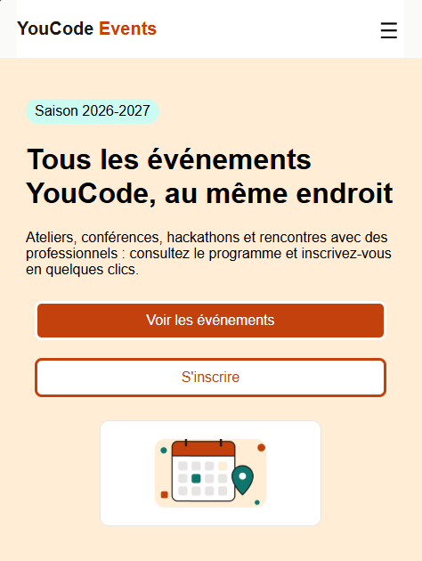
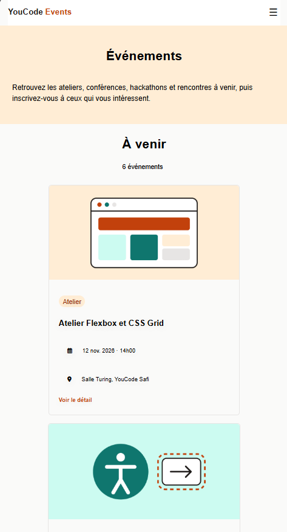
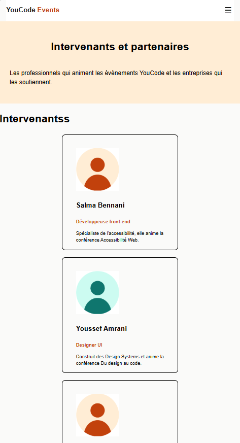
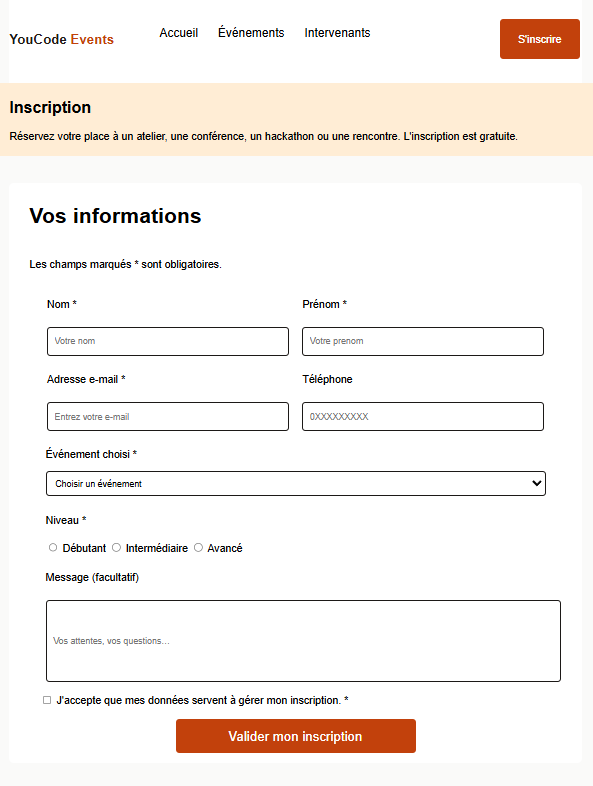

# 🎓 YouCode Events

## 📌 Description du projet

**YouCode Events** est un site web statique, responsive et accessible, développé dans le cadre d'un projet collaboratif à YouCode.

Le site a pour objectif de centraliser les événements organisés par YouCode, tels que les ateliers, conférences, hackathons et rencontres avec des professionnels.

Il permet aux utilisateurs de découvrir les événements à venir, consulter leurs détails, découvrir les intervenants et s'inscrire facilement aux événements.

Ce projet met principalement l'accent sur :
- L'intégration HTML5 et CSS3.
- Le Responsive Design avec une approche Mobile First.
- L'accessibilité Web.
- La collaboration en équipe avec Git et GitHub.
- L'organisation des tâches avec Jira ou GitHub Projects.
- La conception des interfaces avec Figma.

---

## 🎯 Objectifs du projet

- Créer un site web moderne et responsive.
- Respecter les maquettes réalisées sur Figma.
- Utiliser une structure HTML5 sémantique.
- Développer des interfaces adaptées aux différents écrans.
- Appliquer les principes d'accessibilité Web.
- Utiliser CSS Flexbox et CSS Grid.
- Mettre en pratique Git Flow.
- Collaborer à travers des branches et des Pull Requests.

---

## 👥 Membres de l'équipe

Le projet est réalisé en équipe sur un dépôt GitHub commun.

| Membre | Rôle | Pages / Responsabilités |
|--------|------|-------------------------|
| [hiba_zakif] | Développeur Front-End | Page Accueil |
| [ayoub_dehbi] | Développeur Front-End | Page Événements |
| [hiba_zakif] | Développeur Front-End | Page Intervenants |
| [ayoub_dehbi] | Développeur Front-End | Page Inscription |

## 🛠️ Technologies utilisées

### HTML5

Utilisé pour structurer les pages du site avec des balises sémantiques :

- header
- nav
- main
- section
- article
- footer

### CSS3

Utilisé pour la mise en forme et le responsive design :

- Flexbox
- CSS Grid
- Variables CSS
- Media Queries

### JavaScript

Utilisé uniquement pour gérer l'ouverture et la fermeture du menu de navigation sur mobile.

### Figma

Utilisé pour :

- La conception des maquettes.
- La création du Design System.
- Les composants réutilisables.
- Les versions Mobile, Tablette et Desktop.

### Git & GitHub

Utilisés pour :

- Le versionnement du code.
- La gestion des branches.
- La collaboration.
- Les Pull Requests.
- Les revues de code.

### Jira 

Utilisé pour organiser les tâches du projet avec un tableau Kanban.

---

## 📁 Structure du projet

```text
youcode-events/
│
├── index.html
│
├── evenements.html
│
├── evenement-detail.html
│
├── intervenants.html
│
├── inscription.html
│
├── css/
│   ├── style.css
│   ├── index.css
│   ├── inscription.css
│   ├── intervenants.css
│   ├── navbar.css
│   ├── footer.css
│   ├── import.css
│   └── responsive.css
│
│
├── assets/
│   ├── images/
│   └── icons/
│
├── screenshots/
│   ├── accueil.png
│   ├── evenements.png
│   ├── intervenants.png
│   └── inscription.png
│
└── README.md
```

### Description des dossiers

- `css/` : fichiers CSS du projet.
- `assets/images/` : images utilisées dans les pages.
- `assets/icons/` : icônes du site.
- `screenshots/` : captures d'écran du résultat final.

---

## 🌿 Workflow Git et GitHub

L'équipe utilise **Git Flow** pour organiser le développement.

### Branches principales

| Branche | Utilisation |
|---------|-------------|
| `main` | Version stable du projet |
| `develop` | Branche de développement |
| `feature/*` | Développement des fonctionnalités |
| `release/*` | Préparation d'une version |
| `hotfix/*` | Correction urgente |

### Création d'une branche

Chaque fonctionnalité possède sa propre branche.

### Pull Requests

Chaque fonctionnalité doit passer par une Pull Request.

Processus :

1. Créer une issue sur GitHub.
2. Créer une branche `feature/*`.
3. Développer la fonctionnalité.
4. Effectuer les commits.
5. Pousser la branche sur GitHub.
6. Ouvrir une Pull Request vers `develop`.
7. Associer la Pull Request à son issue.
8. Demander une revue de code.
9. Corriger les remarques si nécessaire.
10. Fusionner après approbation.


## 📊 Gestion de projet

Le projet est organisé avec Jira .

Les tâches sont divisées en User Stories et en Issues.

### Organisation du tableau Kanban

Le tableau contient les colonnes suivantes :

- **To Do** : tâches à réaliser.
- **In Progress** : tâches en cours.
- **In Review** : tâches en attente de validation.
- **Done** : tâches terminées.

Chaque tâche est attribuée à un membre de l'équipe.


## 🔗 Liens du projet

### GitHub Repository

🔗 [YouCode Events](https://github.com/ayoubgon/YouCode-Events/tree/main)

### Maquette Figma

🎨 [maquette Figma](https://www.figma.com/design/GdcIHYE8P6L7ohVsoeqAbo/Figma-basics?node-id=0-286&t=NCwwhuaYbXNOa2ax-1)

### Tableau Jira 

📊 [le tableau de gestion](https://ayoubchwawa.atlassian.net/jira/software/projects/KAN/boards/2?filter=&groupBy=none&atlOrigin=eyJpIjoiMTVkMzYxZGY5NjJjNGE1MDkwZGIwOGEyNTIxZDFiOWUiLCJwIjoiaiJ9)

---

## 📸 Captures d'écran

### 🏠 Page d'accueil



### 📅 Page Événements



### 🎤 Page Intervenants



### 📝 Page Inscription



---

## ✅ Conclusion

Le projet **YouCode Events** nous a permis de mettre en pratique les compétences fondamentales du développement Front-End et du travail collaboratif.

À travers ce projet, nous avons travaillé sur :

- La conception UI/UX avec Figma.
- L'intégration HTML5 et CSS3.
- Le Responsive Design avec Media Queries.
- L'accessibilité Web.
- L'organisation du code.
- La gestion des versions avec Git.
- La collaboration avec GitHub et les Pull Requests.
- La gestion des tâches avec Jira Projects.

Ce projet représente une application pratique des bonnes pratiques de développement Web et de collaboration en équipe.

---

## 📄 Licence

Projet pédagogique réalisé dans le cadre de la formation **YouCode**.

© 2026 YouCode Events — Tous droits réservés.
